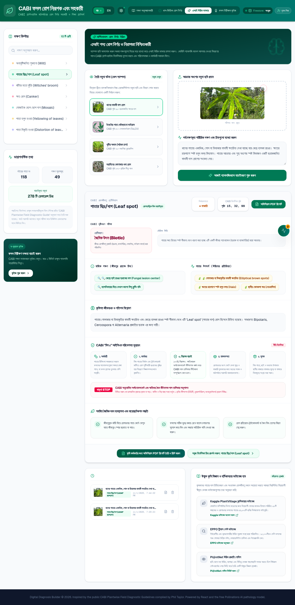

# CABI Plant Diagnosis Assistant

An interactive, AI-powered digital guide to identify crop diseases and pests using visual symptom categories from the **CABI Plantwise Field Diagnostic Guide**.

Built with **Next.js 16 + TypeScript + Tailwind CSS 4 + shadcn/ui**, and powered by **GLM-4.5V** (multimodal vision) and **GLM-4.6** (text) via the `z-ai-web-dev-sdk` — no API key required by the user (bypass SDK).



## Features

1. **Symptom Explorer** — Browse the 10 CABI visual symptom categories (Wilt, Leaf spot, Witches' broom, Canker, Mosaic, Yellowing, Distortion, Little leaf, Galls, Drying/necrosis/blight) with reference images and diagnostic text from the Plantwise Field Diagnostic Guide.
2. **AI Plant Doctor** — Multimodal (image + text) AI diagnosis with:
   - Matched CABI symptom category + confidence level
   - Biotic vs Abiotic categorization with rationale
   - Visible **Signs** (pathogen evidence) vs **Symptoms** (plant reactions)
   - CABI **Big 5** IPM assessment (Economic, Effective, Safe, Practical, Locally Available)
   - 3 organic management recommendations
3. **Step-by-Step Wizard** — Guided 3-step diagnosis flow with crop type selection and preset specimens (Cashew, Tomato, Maize, Bean).
4. **Crop Auditor Quiz** — Visual quiz that tests symptom identification skills against the CABI reference database.
5. **Local Scan History** — Persisted diagnosis logs in `localStorage` for review.

## Bilingual

- 🇧🇩 **Bangla** (default) — full agricultural Bangla translations
- 🇬🇧 **English** — toggle from the header

## Tech Stack

- **Framework**: Next.js 16 (App Router)
- **Language**: TypeScript 5
- **Styling**: Tailwind CSS 4 + shadcn/ui
- **AI**: `z-ai-web-dev-sdk` (GLM-4.5V for vision, GLM-4.6 for text) — bypass API key
- **Animations**: `motion` (Framer Motion)
- **Icons**: `lucide-react`
- **Database**: Prisma (SQLite) — scaffold only; diagnosis uses in-memory cache

## API Routes

- `GET /api/database` — Serves the CABI diagnostic database with three-tier fallback: local cache → GitHub raw fetch → offline mock.
- `POST /api/diagnose` — Multimodal AI diagnosis endpoint. Body: `{ symptomDescription: string, image?: string (base64 data URL), locale?: "bn" | "en" }`. Uses `createVision()` for image+text and `create()` for text-only, both with `thinking: enabled` for high-accuracy reasoning.

## Getting Started

```bash
# Install dependencies
bun install  # or npm install

# Run the dev server
bun run dev  # or npm run dev

# Open http://localhost:3000
```

## Project Structure

```
src/
├── app/
│   ├── api/
│   │   ├── database/route.ts      # CABI database proxy with cache + fallback
│   │   └── diagnose/route.ts      # ZAI SDK bypass diagnosis endpoint
│   ├── layout.tsx                 # Root layout + metadata
│   ├── page.tsx                   # Renders <PlantApp />
│   └── globals.css
├── components/
│   ├── PlantApp.tsx               # Main client component (5 features)
│   └── ui/                        # shadcn/ui components
└── lib/
    ├── types.ts                   # AIDiagnosisResult, DiagnosticKey, etc.
    ├── translations.ts            # Bangla/English translations
    ├── db.ts                      # Prisma client
    └── utils.ts                   # cn() helper
public/
└── output/database.json           # Cached CABI database (40KB, 118 pages)
```

## How the AI Diagnosis Works

The app runs entirely in the browser (no server) and uses a **bring-your-own-key** model so it can deploy as a static site on GitHub Pages with no secrets in the repo.

### Resolution order (see `src/lib/staticDiagnose.ts`)

1. **Live AI (if a key is configured)** — `src/lib/freeAiDiagnose.ts` calls any OpenAI-compatible chat API using the key the user pasted into the in-app settings panel. The default provider is **OpenRouter**, which offers genuinely free models (ids ending in `:free` work even with a $0 balance). The call uses `response_format: json_object` to force structured output.
2. **Heuristic fallback (always available)** — `diagnoseSymptoms()` is a deterministic keyword-matching expert system that maps the symptom text to one of the 10 CABI categories and produces the full structured result. It runs whenever no key is set or the live call fails, so the app never leaves the user without a diagnosis.

### The clinical pathology prompt

Both paths build the same CABI Plantwise-structured prompt and parse the response into `AIDiagnosisResult`:

- Match the symptom to one of **10 CABI visual categories** (Wilt, Leaf spot, Witches' broom, Canker, Mosaic, Yellowing, Distortion, Little leaf, Galls, Drying/necrosis/blight)
- Classify as **Biotic vs Abiotic** (lesion boundaries vs gradients)
- Distinguish **Signs** (pathogen evidence: fruiting bodies, sporulation, frass) from **Symptoms** (plant reactions: wilt, chlorosis, distortion)
- Evaluate organic management against the **CABI Big 5** framework (Economic, Effective, Safe, Practical, Locally Available)

### Enabling live AI (one-time, free)

1. Click the **gear icon** (⚙) in the header — the dot is amber while offline, green when AI is enabled.
2. Sign up at **[openrouter.ai/keys](https://openrouter.ai/keys)** and create a free key (no credit card needed).
3. Paste the key into the **API Key** field. The provider and free model (`meta-llama/llama-3.2-3b-instruct:free`) are pre-filled.
4. Click **Save**. The key is stored only in this browser's `localStorage` — it is never sent to any server other than the AI provider, and never committed to the repo.

The diagnosis then runs against the live model. Clear the key any time from the same panel to return to the offline heuristic.

> **Why bring-your-own-key?** Truly key-less browser AI endpoints now all gate access: Pollinations requires a Cloudflare Turnstile token, Groq blocks CORS, and Puter.js requires a login. OpenRouter is the one free-tier provider that sends permissive CORS headers, so it is the only one callable directly from a static site. The trade-off is one key the user supplies themselves.

## License

This project is based on the CABI Plantwise Field Diagnostic Guide methodology. See [CABI Plantwise](https://www.plantwise.org) for the original guide.

## Acknowledgments

- **CABI Plantwise** for the Field Diagnostic Guide methodology
- **Phil Taylor** — compiler of the original Plantwise Diagnostic Field Guide
- **OpenRouter** for free-model access that makes browser-side AI possible on a static site
