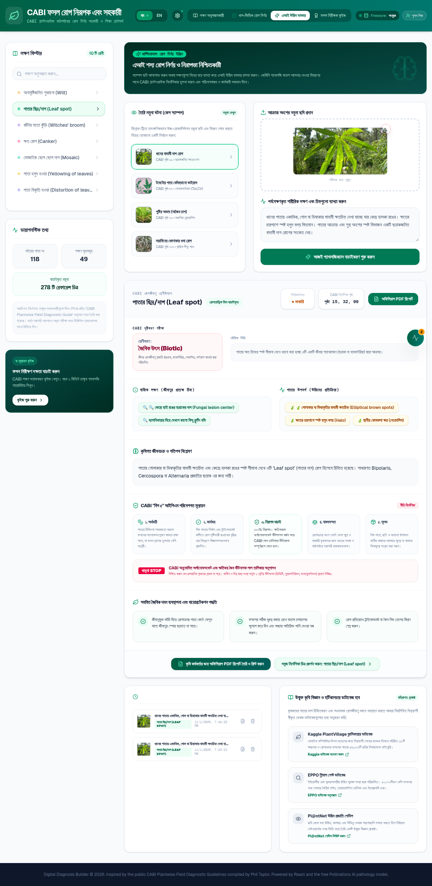

# CABI Plant Diagnosis Assistant

An interactive, AI-powered digital guide to identify crop diseases and pests using visual symptom categories from the **CABI Plantwise Field Diagnostic Guide**.

Built with **Next.js 16 + TypeScript + Tailwind CSS 4 + shadcn/ui** as a fully static site. AI diagnosis is **bring-your-own-key** (any OpenAI-compatible API — OpenRouter free models by default) with a built-in offline heuristic fallback, so no secret ever lives in the repo. Ships as a **mobile-first, Bangla-first installable PWA** with offline caching.



## Features

1. **Symptom Explorer** — Browse the 10 CABI visual symptom categories (Wilt, Leaf spot, Witches' broom, Canker, Mosaic, Yellowing, Distortion, Little leaf, Galls, Drying/necrosis/blight) with reference images and diagnostic text from the Plantwise Field Diagnostic Guide.
2. **AI Plant Doctor** — Multimodal (image + text) AI diagnosis with:
   - Matched CABI symptom category + confidence level
   - Biotic vs Abiotic categorization with rationale
   - Visible **Signs** (pathogen evidence) vs **Symptoms** (plant reactions)
   - CABI **Big 5** IPM assessment (Economic, Effective, Safe, Practical, Locally Available)
   - 3 organic management recommendations
3. **Step-by-Step Wizard** — Guided 3-step diagnosis flow with crop type selection and preset specimens (Cashew, Tomato, Maize, Bean).
4. **Crop Auditor Quiz** — Visual quiz that tests symptom identification skills against the CABI reference database.
5. **Local Scan History** — Persisted diagnosis logs in `localStorage` for review.

## Product boundary and ecosystem role

This repository is the visual training and practice surface. It is not the canonical operational diagnosis record, field-geofence service, pesticide registry or regulatory recommendation engine. Use [CABI Diagnosis](https://github.com/moniruzjaman/cabi-diagnosis) for the operational workflow and [Diagnostic Field Guide](https://github.com/moniruzjaman/diagnostic-field-guide) for the offline reading reference.

Training feedback is educational, not a verified diagnosis or spray instruction. Keep the existing offline heuristic available when AI credentials or connectivity are absent. Do not copy translated Plantwise/CABI passages, tables, images or captions into this app without confirming the CC BY-NC licence and attribution requirements.

## Bilingual

- 🇧🇩 **Bangla** (default) — full agricultural Bangla translations
- 🇬🇧 **English** — toggle from the header

## Tech Stack

- **Framework**: Next.js 16 (App Router) — static export (`output: "export"`)
- **Language**: TypeScript 5
- **Styling**: Tailwind CSS 4 + shadcn/ui
- **AI**: bring-your-own-key, any OpenAI-compatible API (default OpenRouter free models) + offline heuristic fallback
- **PWA**: Workbox service worker (self-hosted), web app manifest, offline precache
- **Animations**: `motion` (Framer Motion)
- **Icons**: `lucide-react`
- **Database**: Prisma (SQLite) — scaffold only; diagnosis runs client-side

## Data & Offline PWA

There is **no server** — the site is a static export served by GitHub Pages:

- `public/output/database.json` — the CABI diagnostic database, fetched by the browser at `<site>/output/database.json` with a built-in offline fallback if the fetch fails.
- `public/sw.js` — self-hosted Workbox service worker: precaches the app shell, stale-while-revalidate for the database, cache-first for specimen images, network-first for navigation with an offline fallback page. All paths derive from the registration scope, so the worker works both at site root and under the GitHub Pages project path.
- `public/og-image.png` — 1200×630 social preview image, wired via OpenGraph + Twitter card metadata in `src/app/layout.tsx` (covers WhatsApp, Facebook, LinkedIn, Telegram, Discord, Slack, iMessage, X/Twitter).
- Installable on Android/iOS (`manifest.webmanifest`, maskable icons, `Service-Worker` registration via `workbox-window`).

## Getting Started

```bash
# Install dependencies
bun install  # or npm install

# Run the dev server
bun run dev  # or npm run dev

# Open http://localhost:3000
```

## Project Structure

```
src/
├── app/
│   ├── layout.tsx                 # Root layout: metadata, OG/Twitter tags, PWA meta
│   ├── manifest.ts                # Web app manifest (generated at build)
│   ├── page.tsx                   # Renders <PlantApp />
│   └── globals.css
├── components/
│   ├── PlantApp.tsx               # Main client component (5 features)
│   ├── DiagnosticReportModal.tsx  # Diagnosis report viewer
│   ├── pwa/                       # SW registration, install button, offline indicator
│   └── ui/                        # shadcn/ui components
├── hooks/                         # usePWAInstall, useOnlineStatus, use-mobile
└── lib/
    ├── types.ts                   # AIDiagnosisResult, DatabaseSchema, etc.
    ├── translations.ts            # Bangla/English translations
    ├── staticDatabase.ts          # Client-side DB loader + offline fallback
    ├── staticDiagnose.ts          # Resolution order: live AI → heuristic
    ├── freeAiDiagnose.ts          # BYOK OpenAI-compatible diagnosis
    └── utils.ts                   # cn() helper
public/
├── output/database.json           # CABI database, served statically
├── sw.js + workbox/               # Self-hosted Workbox service worker
└── og-image.png                   # 1200×630 social share preview
```

## How the AI Diagnosis Works

The app runs entirely in the browser (no server) and uses a **bring-your-own-key** model so it can deploy as a static site on GitHub Pages with no secrets in the repo.

### Resolution order (see `src/lib/staticDiagnose.ts`)

1. **Live AI (if a key is configured)** — `src/lib/freeAiDiagnose.ts` calls any OpenAI-compatible chat API using the key the user pasted into the in-app settings panel. The default provider is **OpenRouter**, which offers genuinely free models (ids ending in `:free` work even with a $0 balance). The call uses `response_format: json_object` to force structured output.
2. **Heuristic fallback (always available)** — `diagnoseSymptoms()` is a deterministic keyword-matching expert system that maps the symptom text to one of the 10 CABI categories and produces the full structured result. It runs whenever no key is set or the live call fails, so the app never leaves the user without a diagnosis.

### The clinical pathology prompt

Both paths build the same CABI Plantwise-structured prompt and parse the response into `AIDiagnosisResult`:

- Match the symptom to one of **10 CABI visual categories** (Wilt, Leaf spot, Witches' broom, Canker, Mosaic, Yellowing, Distortion, Little leaf, Galls, Drying/necrosis/blight)
- Classify as **Biotic vs Abiotic** (lesion boundaries vs gradients)
- Distinguish **Signs** (pathogen evidence: fruiting bodies, sporulation, frass) from **Symptoms** (plant reactions: wilt, chlorosis, distortion)
- Evaluate organic management against the **CABI Big 5** framework (Economic, Effective, Safe, Practical, Locally Available)

### Enabling live AI (one-time, free)

1. Click the **gear icon** (⚙) in the header — the dot is amber while offline, green when AI is enabled.
2. Sign up at **[openrouter.ai/keys](https://openrouter.ai/keys)** and create a free key (no credit card needed).
3. Paste the key into the **API Key** field. The provider and free model (`meta-llama/llama-3.2-3b-instruct:free`) are pre-filled.
4. Click **Save**. The key is stored only in this browser's `localStorage` — it is never sent to any server other than the AI provider, and never committed to the repo.

The diagnosis then runs against the live model. Clear the key any time from the same panel to return to the offline heuristic.

> **Why bring-your-own-key?** Truly key-less browser AI endpoints now all gate access: Pollinations requires a Cloudflare Turnstile token, Groq blocks CORS, and Puter.js requires a login. OpenRouter is the one free-tier provider that sends permissive CORS headers, so it is the only one callable directly from a static site. The trade-off is one key the user supplies themselves.

## Deployment (GitHub Pages)

Deploys automatically on every push to `main` via `.github/workflows/deploy.yml`:
bun install → `bun run build` (static export to `out/`) → `.nojekyll` → `actions/deploy-pages@v4`.

Live URL: **https://moniruzjaman.github.io/diagnosis-assistant/**

Everything is wired for the project-site path:

- `next.config.ts` — `basePath: "/diagnosis-assistant"`, `trailingSlash: true`, `images.unoptimized`
- `src/app/layout.tsx` — `metadataBase`, canonical URL, and OG/Twitter image URLs carry the basePath prefix
- `public/sw.js` — all cache paths derive from the service-worker registration scope, so offline caching works under the project path too
- `404.html` — generated by the static export; GitHub Pages serves it for unknown routes

Prerequisites in the repo settings: **Settings → Pages → Source: GitHub Actions**. Optionally upload `public/og-image.png` as the repo **Social preview** (Settings → General) for the repo-link card.

## License

This project is based on the CABI Plantwise Field Diagnostic Guide methodology. See [CABI Plantwise](https://www.plantwise.org) for the original guide.

## Acknowledgments

- **CABI Plantwise** for the Field Diagnostic Guide methodology
- **Phil Taylor** — compiler of the original Plantwise Diagnostic Field Guide
- **OpenRouter** for free-model access that makes browser-side AI possible on a static site
